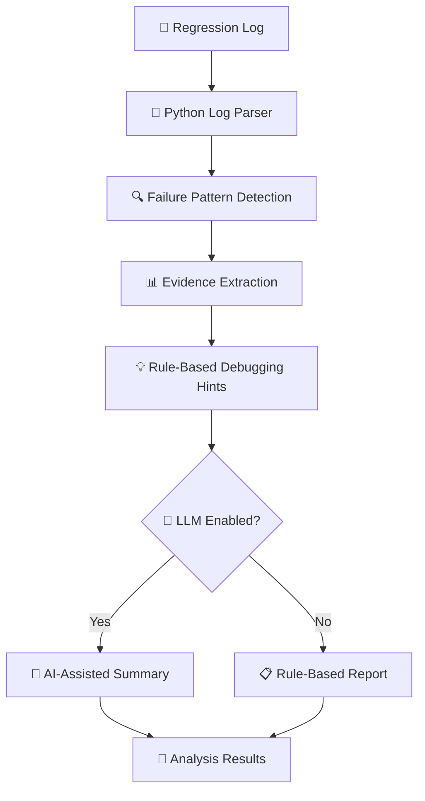

# 🔍 AI-Powered Regression Log Analyzer

<p align="center">
  
  
  
  
  
</p>

<p align="center">
  <b>AI-Assisted Log Analysis | Failure Detection | Debugging Insights</b>
</p>

A Python-based engineering support tool that analyzes regression-style logs, identifies common failure patterns, and generates actionable debugging hints. It combines rule-based analysis with optional Large Language Model (LLM) integration for AI-assisted error summarization.

> **Project scope:** This project initially uses synthetic regression logs and predefined error patterns. It has not been validated against real PCIe hardware, production regression environments, or proprietary simulator output.

---

## 📌 Table of Contents

- [🎯 Overview](#-overview)
- [✨ Features](#-features)
- [🛠️ Tech Stack](#️-tech-stack)
- [⚙️ Workflow](#️-workflow)
- [📂 Project Structure](#-project-structure)
- [🚀 Installation and Setup](#-installation-and-setup)
- [🔌 API Endpoints](#-api-endpoints)
- [🤖 Optional LLM Integration](#-optional-llm-integration)
- [🧪 Testing](#-testing)
- [⚠️ Limitations](#️-limitations)
- [🔮 Future Improvements](#-future-improvements)

---

## 🎯 Overview

Regression testing produces logs containing errors, warnings, failed tests, and diagnostic information. Manually inspecting these logs can be time-consuming.

The Regression Log Analyzer aims to simplify the initial investigation by extracting failure signals, classifying common error patterns, and providing debugging hints. An optional LLM endpoint can generate a natural-language summary of the available evidence.

### 🎯 Objectives

- Reduce repetitive manual log inspection.
- Identify common regression failure patterns.
- Organize diagnostic evidence for easier investigation.
- Explore the use of LLMs for engineering workflow assistance.
- Provide a simple REST API for integration with other tools.

---

## ✨ Features

| Icon | Feature | Description |
|---|---|---|
| 🔍 | Log Analysis | Processes regression-style log text |
| 🚨 | Error Detection | Identifies common failure and warning messages |
| 🧩 | Error Classification | Categorizes timeouts, assertion failures, connection errors, memory errors, and compilation errors |
| 💡 | Debugging Hints | Suggests possible causes and investigation steps |
| 🧠 | LLM Summarization | Optionally generates AI-assisted summaries |
| ⚡ | REST API | Exposes functionality through FastAPI |
| 🧪 | Automated Testing | Tests expected behavior using Pytest |
| 🛡️ | Cautious Analysis | Separates detected evidence from unconfirmed root-cause hypotheses |

---

## 🛠️ Tech Stack

- **Language:** Python
- **API Framework:** FastAPI
- **AI Integration:** OpenAI API (optional)
- **Testing:** Pytest
- **Server:** Uvicorn
- **Version Control:** Git and GitHub

---

## ⚙️ Workflow



The rule-based analysis works without an API key. The optional LLM endpoint requires a configured OpenAI API key.

---

## 📂 Project Structure

```text
ai-powered-regression-log-analyzer/
│
├── app/
│   ├── __init__.py
│   ├── analyzer.py
│   └── main.py
│
├── sample_logs/
│   └── sample_regression.log
│
├── tests/
│   └── test_analyzer.py
│
├── .env.example
├── .gitignore
├── requirements.txt
└── README.md
```

---

## 🚀 Installation and Setup

### Prerequisites

- Python 3.10 or newer
- pip
- Git (optional if downloading the source as a ZIP)

### 1️⃣ Clone the Repository

Replace `YOUR_USERNAME` with your GitHub username.

```bash
git clone https://github.com/YOUR_USERNAME/ai-powered-regression-log-analyzer.git
cd ai-powered-regression-log-analyzer
```

Alternatively, download the repository ZIP from GitHub and extract it.

### 2️⃣ Create a Virtual Environment

**Windows PowerShell**

```powershell
python -m venv .venv
.\.venv\Scripts\Activate.ps1
```

**Linux/macOS**

```bash
python3 -m venv .venv
source .venv/bin/activate
```

### 3️⃣ Install Dependencies

```bash
pip install -r requirements.txt
```

### 4️⃣ Run Automated Tests

```bash
pytest -q
```

### 5️⃣ Start the Application

```bash
uvicorn app.main:app --reload
```

The API will be available at:

- **API base URL:** http://127.0.0.1:8000
- **Interactive API documentation:** http://127.0.0.1:8000/docs

---

## 🔌 API Endpoints

| Method | Endpoint | Purpose |
|---|---|---|
| `GET` | `/health` | Checks API availability |
| `POST` | `/analyze` | Performs rule-based log analysis |
| `POST` | `/analyze/llm` | Adds an optional LLM-generated summary |

### 🩺 Health Check

Send a `GET` request to `/health`.

Example response:

```json
{
  "status": "ok"
}
```

### 🔍 Analyze a Regression Log

Send a `POST` request to `/analyze`.

Example JSON request:

```json
{
  "log_text": "INFO Starting regression\nERROR Connection refused\nFAIL smoke_test"
}
```

The response includes:

- Overall analysis status
- Detected failure lines
- Warning lines
- Error categories
- Evidence lines
- Suggested debugging hints

### 🧪 Example Using Python

```python
import requests

url = "http://127.0.0.1:8000/analyze"

payload = {
    "log_text": (
        "INFO Starting regression\n"
        "ERROR Connection refused\n"
        "FAIL smoke_test"
    )
}

response = requests.post(url, json=payload, timeout=10)
response.raise_for_status()

print(response.json())
```

Install the optional client dependency if needed:

```bash
pip install requests
```

---

## 🤖LLM Integration

The `/analyze/llm` endpoint combines rule-based analysis with an LLM-generated summary.

### Configure the API Key

**Windows PowerShell**

```powershell
$env:OPENAI_API_KEY="your-api-key"
$env:OPENAI_MODEL="gpt-4.1-mini"
```

**Linux/macOS**

```bash
export OPENAI_API_KEY="your-api-key"
export OPENAI_MODEL="gpt-4.1-mini"
```

Then send a `POST` request to `/analyze/llm` using the same JSON request structure as `/analyze`.

**Important:**

- An OpenAI API key and appropriate API access are required.
- API calls may incur charges.
- Never commit API keys or secret environment files to GitHub.
- Review generated summaries before using them for debugging decisions.
- Avoid sending confidential logs, credentials, or proprietary information to external services without authorization.

---

## 🧪 Testing

The project includes automated tests for common scenarios:

- ⏱️ Timeout detection
- 🚨 Failure detection
- ⚠️ Warning-only logs
- ✅ Logs without obvious failures

Run the tests using:

```bash
pytest -q
```

These tests check predefined scenarios; they do not establish production readiness or accuracy on real engineering datasets.

---

## ⚠️ Limitations

- Detection relies on predefined patterns and may miss unfamiliar error formats.
- Suggested root causes are hypotheses, not confirmed diagnoses.
- Initial testing uses synthetic regression logs.
- The project has not been validated against real PCIe hardware or production simulator output.
- LLM-generated summaries may contain inaccurate suggestions and require human review.

---

## 🔮 Future Improvements

- 📈 Evaluate precision and recall on labelled log datasets.
- 🧩 Add support for more regression and simulator log formats.
- 🔐 Redact sensitive information before external API calls.
- 🔄 Integrate GitHub Actions for continuous integration.
- 📊 Add a dashboard for browsing failures and trends.
- 🧪 Expand tests for complex and overlapping failure patterns.
- 🐧 Improve Linux deployment and operational monitoring.

---

## 👩‍💻 Author

**Soumya Safallya Sahoo**

B.Tech — Computer Science and Engineering

Interested in AI/ML, LLM-based automation, Python development, and engineering tools.
